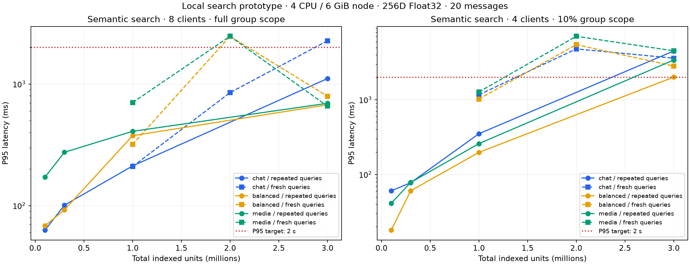

# 混合消息检索容量：实测记录

口径：**4 核 / 6 GiB、P95 ≤ 2 秒、每次 20 条消息**。三种混合语料共同通过的检查点是 **约 100 万检索单元**。200 万单元的新查询超标。实测边界在 100 万与 200 万之间，不能插值成硬上限。

## 可确认的混合数据规模

| 混合比例：文字/图片/音频/视频 | 总检索单元 | 当前 group 可搜索消息 | 100 万点最差 P95 | 200 万点最差 P95 |
| --- | ---: | ---: | ---: | ---: |
| 90/5/4/1 | 1,000,000 | 452,848 | 1.17 秒 | 4.80 秒 |
| 60/20/15/5 + 长视频尾部 | 1,000,032 | 151,549 | 1.02 秒 | 5.46 秒 |
| 20/20/30/30 | 1,000,010 | 43,020 | 1.27 秒 | 7.07 秒 |

这是合成语料上的引擎能力，不是产品 SLA。100 万点的平均 Recall@20 均不低于 99.2%（逐向量精确对照）。通过条件见 [README](../../README.md#prototype-scope)。并发为闭环客户端。

## 测试条件

本机独立 OpenSearch 3.8.0，4 CPU、6 GiB、2 GiB JVM heap。合成 256 维向量与模拟文本，只测检索。范围与排除项见 [README](../../README.md#prototype-scope)。

## 全部检查点

| 混合类型 | 查询组 / ef | 总检索单元 | 总消息 | 本 group 可搜索消息 | 全范围 C8 P95 ms | 10%范围 C4 P95 ms | C8 平均 Recall@20 |
| --- | --- | ---: | ---: | ---: | ---: | ---: | ---: |
| balanced | 24 查询 × 3 / 200 | 100,194 | 15,952 | 15,155 | 68.3 | 18.0 | 99.79% |
| balanced | 24 查询 × 3 / 200 | 300,005 | 48,156 | 45,749 | 92.4 | 60.6 | 100.00% |
| balanced | 24 查询 × 3 / 200 | 1,000,032 | 159,525 | 151,549 | 376.2 | 197.7 | 99.79% |
| balanced | prefix-fresh64 / 200 | 1,000,032 | 159,525 | 151,549 | 319.1 | 1020.8 | 99.30% |
| balanced | prefix-fresh64 / 200 | 2,000,042 | 319,724 | 303,738 | 2469.0 | 5464.7 | 99.06% |
| balanced | 24 查询 × 3 / 200 | 3,000,011 | 477,726 | 453,840 | 674.9 | 2009.9 | 98.33% |
| balanced | fresh64 / 200 | 3,000,011 | 477,726 | 453,840 | 793.8 | 2827.0 | 98.20% |
| chat | 24 查询 × 3 / 200 | 100,001 | 47,469 | 45,096 | 62.8 | 60.5 | 100.00% |
| chat | 24 查询 × 3 / 200 | 300,001 | 141,832 | 134,741 | 100.9 | 77.7 | 100.00% |
| chat | 24 查询 × 3 / 200 | 1,000,000 | 476,682 | 452,848 | 212.3 | 351.1 | 100.00% |
| chat | prefix-fresh64 / 200 | 1,000,000 | 476,682 | 452,848 | 209.8 | 1166.6 | 100.00% |
| chat | prefix-fresh64 / 200 | 2,000,030 | 953,432 | 905,761 | 849.9 | 4795.7 | 99.77% |
| chat | 24 查询 × 3 / 200 | 3,000,004 | 1,435,053 | 1,363,301 | 1108.8 | 4493.0 | 99.79% |
| chat | fresh64 / 200 | 3,000,004 | 1,435,053 | 1,363,301 | 2267.0 | 3606.1 | 99.69% |
| diffuse | 24 查询 × 1 / 200 | 100,007 | 17,945 | 17,048 | 33.1 | 40.5 | 83.13% |
| diffuse | 24 查询 × 1 / 200 | 300,006 | 52,713 | 50,078 | 388.7 | 71.0 | 76.67% |
| diffuse | tuned2000 / 2000 | 300,006 | 52,713 | 50,078 | 292.9 | 46.9 | 97.71% |
| media | 24 查询 × 3 / 200 | 100,007 | 4,441 | 4,219 | 171.4 | 41.3 | 96.88% |
| media | 24 查询 × 3 / 200 | 300,034 | 13,394 | 12,725 | 274.8 | 78.3 | 98.54% |
| media | 24 查询 × 3 / 200 | 1,000,010 | 45,284 | 43,020 | 408.6 | 259.0 | 99.38% |
| media | prefix-fresh64 / 200 | 1,000,010 | 45,284 | 43,020 | 704.6 | 1272.1 | 99.30% |
| media | prefix-fresh64 / 200 | 2,000,040 | 90,488 | 85,964 | 2468.0 | 7073.7 | 98.67% |
| media | 24 查询 × 3 / 200 | 3,000,017 | 135,424 | 128,653 | 694.8 | 3403.2 | 97.50% |
| media | fresh64 / 200 | 3,000,017 | 135,424 | 128,653 | 658.1 | 4523.2 | 97.73% |

## 100 万检查点的质量与吞吐

每条件 64 个独立查询。QPS 为闭环实测值。

| 混合类型 | 全范围 C8 QPS | 10%范围 C4 QPS | 所有语义条件中最低平均召回 | 最低单次召回 | 最低满页率 |
| --- | ---: | ---: | ---: | ---: | ---: |
| balanced | 34.6 | 15.3 | 99.30% | 90.0% | 100.0% |
| chat | 50.8 | 16.1 | 99.92% | 95.0% | 100.0% |
| media | 17.2 | 9.7 | 99.30% | 90.0% | 100.0% |

## 解读边界

- 混合比例和单元数见 [README](../../README.md#mixtures)。单元数不等于消息数。
- fresh 测量每个条件使用新种子查询，没有清除 OS 页缓存。
- 200 万和 300 万的延迟不单调（段布局、合并、缓存不同）。两者都在部分条件下超标。不能用较快结果覆盖较慢结果。
- 300 万 chat 的 10% 范围查询，重复三轮 P95 为 5.27 秒、1.13 秒、0.307 秒。重复查询会掩盖首次查询压力。新查询在三种比例上为 2.83 至 4.52 秒。
- 本报告不证明新入口、group 授权、发布校验或 Cloud 迁移已实现。

## 向量分布与参数敏感性

diffuse 语料在 ef/k=200 时，10 万和 30 万单元的平均 Recall@20 仅为 83.1% 和 76.7%，不达标。同一 30 万索引调到 ef/k=2000 后为 97.7%。容量结论依赖搜索参数和向量分布。未外推到 100 万或真实 WeMM 数据。

## 长视频与消息归并

一条视频的 500 个高分片段加 40 条其他消息：先取 200 个片段再 collapse 只返回 1 条消息。nested 多向量召回返回 20 条。41 条消息分页为 20/20/1，无重复。scope 刷新后移除了不再符合的结果。这不替代产品撤销协议。

## ClickHouse 窄表对照

ClickHouse 26.8.2.7，4 核 / 6 GiB，独立运行。balanced 语料前缀，每条件 24 次。exact 按消息取最佳片段。ann200 先取 200 个片段再归并。二者都不是生产 SQL。

| 总检索单元 | 算法 | 全范围 C8 P95 ms | 10%范围 C4 P95 ms | C8 平均 Recall@20 | C8 错误数 |
| ---: | --- | ---: | ---: | ---: | ---: |
| 100,194 | exact | 106.3 | 22.3 | 100.00% | 0 |
| 100,194 | ann200 | 79.5 | 19.5 | 87.08% | 0 |
| 300,005 | exact | 667.4 | 112.3 | 100.00% | 0 |
| 300,005 | ann200 | 182.9 | 33.2 | 95.83% | 0 |
| 1,000,032 | exact | 2514.6 | 158.1 | 100.00% | 0 |
| 1,000,032 | ann200 | 1041.3 | 144.4 | 96.67% | 0 |

**失败点：3,000,011 单元、exact 路径预热失败：** TIMEOUT_EXCEEDED: elapsed 10033.170 ms, maximum 10000.000 ms。该算法在此规模没有完成并发测量，不能将缺失行视为通过。

3,000,011 单元的 ann200 后续测量在 C1 就出现错误：P95 9.83 秒，24 次中 2 次超时，成功请求平均 Recall@20 89.32%（最低 55.0%）。因此停止加并发，未生成 C4/C8 通过数据。

ANN 部分检查点平均 Recall@20 低于 95%。计时请求使用 rescoring=1。早期 EXPLAIN 用默认 rescoring=0，只确认 HNSW 参与。

## 原始结果复核与资源观测

OpenSearch 的 11,160 次计时请求没有搜索错误。包含 ClickHouse 的全部 11,904 次计时请求中有 2 次错误，另有 1 次预热失败，均保留。没有跳过的计时请求。
对照生成器元数据检查了 235,656 个返回命中，未发现租户、group-connect、日期串入、越出前缀或单页重复。两个节点的 cgroup 峰值都触及 6 GiB，未记录 OOM kill。OpenSearch 资源监控有 8 个失败采样点。

## 复跑与证据

方法见 [README](../../README.md)。`.json.gz` 保存逐请求数据，`summary.json` 是汇总，`audit.json` 是范围核对，`environment.json` 是节点配置。本次没有部署、改动生产数据或压测外部 provider。
