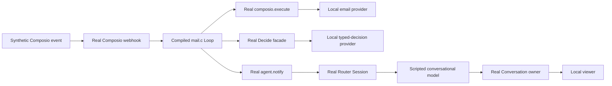

# Proactive chat prototype

This local prototype checks whether existing Salix components can deliver an unsolicited Router chat message from an email event.
It is not a production watcher.

## Run

From the repository root:

```sh
make prototype-proactive-chat
```

Open the printed `PROTOTYPE_URL`.
Use the scenario selector to inspect source input, decision requests, Session wakes, and Conversation messages.
A passing failure scenario means the simulator reproduced that failure, not that delivery succeeded.

Other modes:

```sh
make prototype-proactive-chat PROACTIVE_PROTOTYPE_ARGS=--all
bash systems/scripts/proactive-chat-prototype/run.sh --case important
bash systems/scripts/proactive-chat-prototype/run.sh
```

The last command opens a terminal menu.
Batch mode writes `results.local.json` and returns a nonzero exit code if a scenario fails its checks.
Requirements: Docker, the repository's Elixir dependencies, and its native build toolchains.
The launcher starts its own PostgreSQL and Redis containers on loopback ports.
It never reads Gmail credentials or calls a real model provider.

Stop the running command with Ctrl-C.
Stop the prototype dependencies when finished:

```sh
docker stop comma-proactive-prototype-pg comma-proactive-prototype-redis
```

The database belongs to this prototype, and each start resets it.
These are not whole-service persistence or disaster-recovery tests.

## What executes



- `mail.c` is the workflow under test, compiled through the existing spinfoam build service.
- Gmail query construction, MIME parsing, OAuth consent, and live trigger registration are not verified.
- The decision fixture checks data flow and branching. It does not evaluate model usefulness or resistance to prompt injection.
- An acknowledgement means processing reached the Session handoff. The viewer separately checks that a visible message exists.
- The simulator creates an isolated Salix Router Conversation. Comma login, Workspace mapping, and client subscriptions are not verified.

## Scenarios

| Scenario | Expected result |
| --- | --- |
| important | One visible reminder. The first chat-model request contains the body. |
| quiet | Same subject, opposite body. No reminder. |
| missing_body | Source error. No model request and no acknowledgement. |
| model_error | Two failed attempts, then an explicit error checkpoint. No reminder. |
| uncertain | Defer with no acknowledgement. No fabricated quiet decision. |
| duplicate | One source read, one decision, and one visible reminder after repeated event delivery. |
| foreign_account | HTTP 422 before source read or model use. |
| restart | The durable inbox replays a 202 event after owner restart, without upstream redelivery. Later redelivery remains a duplicate. |
| model_redelivery | Runtime deduplication suppresses redelivery of a failed event, even without a business acknowledgement. |
| model_retry | The Loop keeps the event and retries once after provider recovery. One visible reminder. |

spinfoam remembers event IDs on mailbox admission, not on business completion.
Do not use provider redelivery as the model retry mechanism.

## Real-model Home acceptance

`acceptance.exs` starts the real Comma API, Router, Worker, scheduler, and S3 adapter.
It replaces only the Gmail and Composio transport with fictional mail.
It permits no outbound email operations.
It is for diagnosing fictional mail with real models. It is not live Gmail acceptance.

This opt-in fixture requires an authorized model configuration in a private JSON file.
Set `MAIL_ACCEPTANCE_MODEL_CONFIG` to that file. It contains `decide` and `llm` configuration.
Never commit the configuration or `acceptance.local.json`, which contains a test session token.
The fixture uses local PostgreSQL port 32787, Redis port 32786, and MinIO port 32790.
Its databases are `comma_mail_acceptance`, `comma_mail_acceptance_comma`, and `comma_mail_acceptance_billing`.
Its S3 bucket is `comma-proactive-acceptance`. Do not share these with another service.
`--reset` resets the named Salix test database and creates a fresh fictional workspace.
Omit it to keep the existing workspace and generated monitor for diagnosis.

From `systems`, run:

```sh
MIX_ENV=test SALIX_TEST_DB_PORT=32787 COMMA_TEST_DB_PORT=32787 \
SALIX_TRANSFER_PORT=0 REDIS_URL=redis://127.0.0.1:32786/1 \
mix run --no-start --no-compile scripts/proactive-chat-prototype/acceptance.exs --reset
```

`CommaWeb.LocalRecommendationFlowTest` covers the product check, its judgment, and its message budget.

## Decision comparison harness

Use `harness/` for model comparisons. The older `compare*.exs` scripts are historical experiments.
This harness does not start product applications, read a mailbox, or publish messages.
Its output contract is experimental.

Run the local checks before paid provider calls:

```sh
bash systems/scripts/proactive-chat-prototype/harness/check.sh
```

These checks need no credentials, database, or network model provider.
Elixir dependencies and the existing spinfoam compiler and runtime must be available.

From `systems`, run a real-provider comparison:

```sh
MIX_ENV=test mix run --no-start --no-compile \
  scripts/proactive-chat-prototype/harness/run.exs \
  --config /absolute/path/to/private-model-config.json \
  --corpus scripts/proactive-chat-prototype/harness/evaluation.json \
  --output /absolute/path/to/new-run-directory \
  --variants a,b,c --rounds 2
```

The private configuration uses the same `decide` and `llm` fields as the Home acceptance fixture.
Do not commit it. The manifest records model names and prompts, but no endpoint or credential.
Each run requires a new output directory.

| Variant | Model input and flow |
| --- | --- |
| `a` | Jev sees mail and Home. Code builds fixed excerpt text. |
| `b` | Jev sees mail only. A notify result reaches Router with mail and Home. |
| `c` | Router sees mail and Home for every case. |
| `b_context` | Same B flow and prompts, but Jev also receives Home. This isolates context availability. |
| `d` | A frozen generated C program runs through the real compiler and event runtime. Its Router calls use the common output contract. |

All variants use the same output: decision, optional title and body, source reference, and allowed actions.
Code supplies the source and actions from the case fixture. The model cannot create either field.
A valid shape does not prove that every statement is correct. Fact anchors check selected details, and `drafts.json` keeps text for inspection.

`development.json` contains historical cases. `evaluation.json` contains additional cases with declared expected outcomes.
Expected outcomes and fact anchors never reach a provider.
The run records complete fictional decision inputs and outputs. Do not substitute real private mail without adapting data handling.
Repeated runs of this corpus are regressions, not fresh held-out evaluation.

To run D, add `--variants d --d-source /absolute/path/to/generated.c`.
The runner copies the supplied program into the result directory.
A frozen-program pass does not prove reliable cold generation, durable queues, permission checks, recovery, or UI delivery.
D source and ACK adapters are synthetic. Jev and Router-model calls are real.

The result directory contains `manifest.json`, `corpus.json`, `rows.jsonl`, `summary.json`, `drafts.json`, and `completed.json`.
Unknown usage is not zero cost. Currency cost stays unknown until someone supplies an authoritative tariff.
Exit code 2 means at least one execution or contract error.
Exit code 0 is not model-quality acceptance. Always inspect the summary.

Render a report without more model calls:

```sh
python3 scripts/proactive-chat-prototype/harness/report.py /absolute/path/to/run-directory
```

If you correct a scorer defect, keep the original run and create a separate rescore directory:

```sh
MIX_ENV=test mix run --no-start --no-compile \
  scripts/proactive-chat-prototype/harness/rescore.exs \
  /absolute/path/to/original-run /absolute/path/to/new-rescore-directory
```

Rescoring makes no provider calls and does not change source outputs or expected decisions.
Keep its manifest explanation specific to the scoring or accounting correction.
